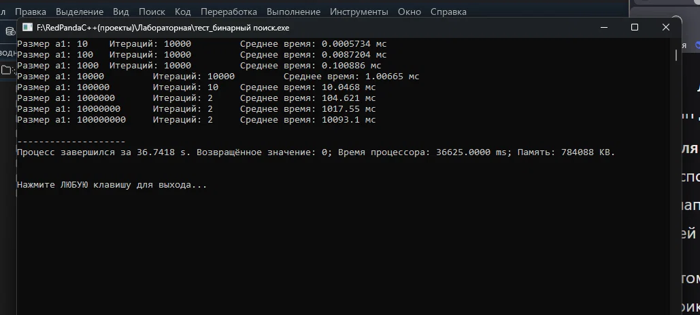
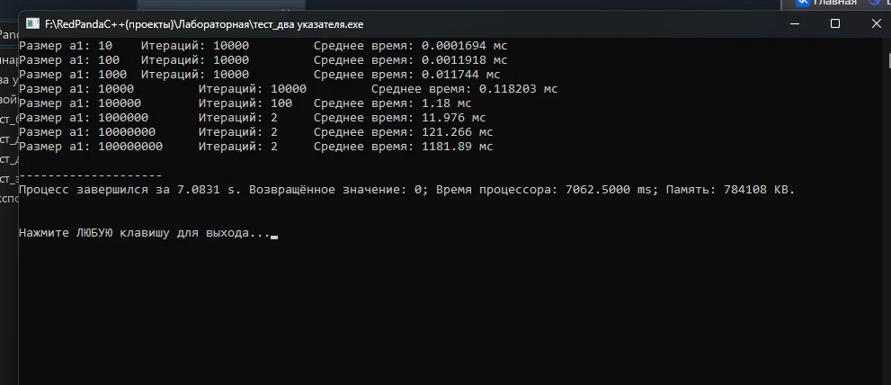
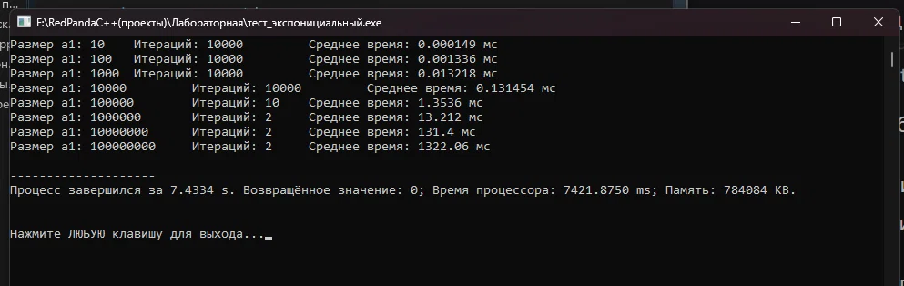
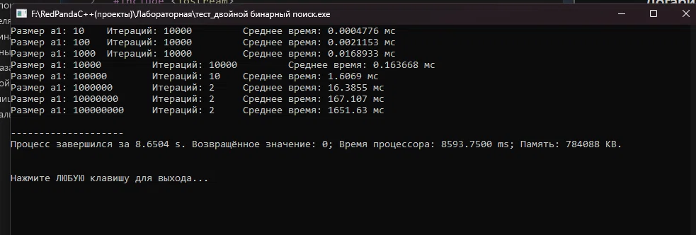
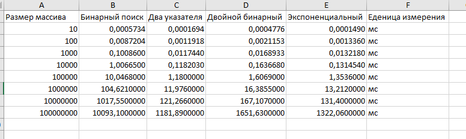
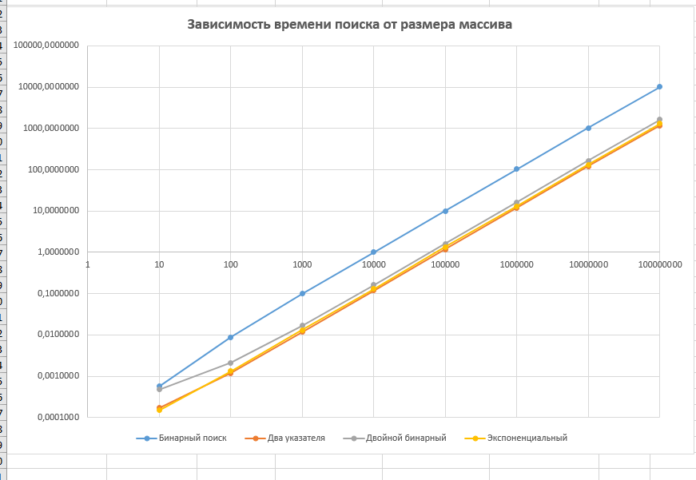

# Лабораторная работа 1

## Условие

Даны два отсортированных массива целых чисел (длины M и N). Нужно вернуть `True`, если в них есть хотя бы один общий элемент, иначе `False`.

Цель работы: реализовать четыре разных решения этой задачи и выяснить, при каком размере массивов какой алгоритм работает эффективнее.

Сравниваемые алгоритмы:

- два указателя
- бинарный поиск
- экспоненциальный поиск
- двойной бинарный поиск (с разделением)

## Ход работы

### 1. Алгоритмы

Я написал 4 алгоритма. Они лежат в этом репозитории, в файлах с пометкой `решение`.

### 2. Тесты

Затем я написал код с тестовыми данными. Эти файлы в репозитории помечены как `тест`. В них каждый алгоритм проверяется на худшем случае: общих элементов в массивах нет, поэтому алгоритм не может остановиться раньше времени.

Условия тестов:

- второй массив всегда размером 10⁸ (нечётные числа);
- размер первого массива меняется от 10 до 10⁸ (чётные числа);
- для каждого размера тест запускается несколько раз и считается среднее время.

### 3. Результаты тестов

Запустив тесты, получаем такие результаты.

**Бинарный поиск**

**Два указателя**

**Экспоненциальный поиск**

**Двойной бинарный поиск**

### 4. Таблица в Excel

Из этих результатов составляем таблицу в Excel (время в миллисекундах). Файл Excel лежит в репозитории.

### 5. График

По данным из таблицы строим график с логарифмическими осями. На нём видно, как меняется время работы каждого алгоритма при росте размера массива.

## Итоги

По результатам я сделал вывод. Он оформлен в файле формата Word (`.docx`), который тоже лежит в этом репозитории. Коротко: быстрее всех оказался алгоритм двух указателей, медленнее всех обычный бинарный поиск.
