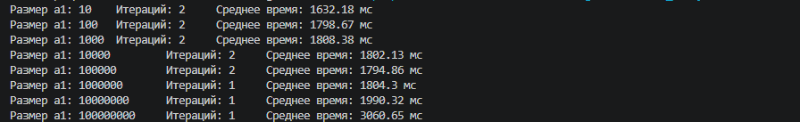
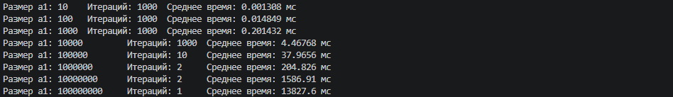
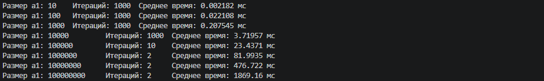
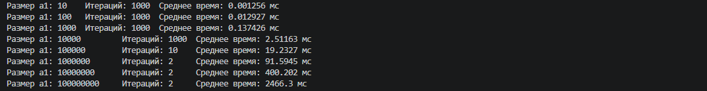
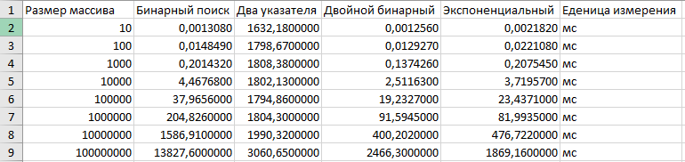
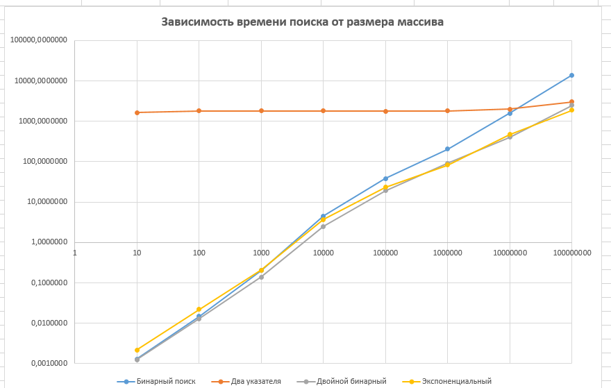

# Лабораторная работа 1

## Задача

Даны два отсортированных массива: `a1` длины M и `a2` длины N. Нужно определить, есть ли в них общий элемент.

## Цель

Сравнить время работы четырёх алгоритмов поиска общего элемента в зависимости от размера массива `a1` и выяснить, какой из них эффективнее в каком диапазоне размеров.

## Алгоритмы

| Алгоритм | Файл решения | Файл теста | Сложность |
|---|---|---|---|
| Два указателя | `Два указателя_решение.cpp` | `тест_два указателя.cpp` | O(M + N) |
| Бинарный поиск | `Бинарный поиск_решение.cpp` | `тест_бинарный поиск.cpp` | O(M · log N) |
| Экспоненциальный поиск | `Экспонициальный_решение.cpp` | `тест_экспонициальный.cpp` | ≈ O(M · log(N/M)) |
| Двойной бинарный поиск | `Двойной бинарный поиск_решение.cpp` | `тест_двойной бинарный поиск.cpp` | ≈ O(M · log(N/M)) |

## Тесты

Замеры проводятся на **худшем случае**, когда общих элементов нет и алгоритму приходится обработать все данные.

- `a2` — N = 10^8 нечётных чисел.
- `a1` — M чётных чисел, M = 10, 100, 1000, …, 10^8. Элементы формируются как `2 * i * (100000000 / size) + 2`, поэтому они равномерно распределены по всему диапазону `a2`. Общих элементов нет (чётные и нечётные числа не совпадают), переполнения `int` нет.
- Время измеряется через `std::chrono`. Результат записывается в `volatile`-переменную, чтобы компилятор не выбросил вызов. Для малых размеров замер повторяется много раз (до 1000), для больших — 1–2 раза, затем берётся среднее время одного вызова.
- Сборка: `g++` с оптимизацией `-O2`.

## Результаты

### Запуски тестов

**Два указателя**

**Бинарный поиск**

**Экспоненциальный поиск**

**Двойной бинарный поиск**

### Сводная таблица

Исходные данные: `Сравнение времени работы алгоритмов поиска в зависимости от размера массива.xlsx`.

### График (логарифмический масштаб по обеим осям)

## Вывод

- **Два указателя** почти не зависят от M: около 1,6–1,8 с до M = 10^6, 1,99 с при 10^7 и 3,06 с при 10^8. Алгоритм проходит почти весь `a2` (10^8 элементов), поэтому время определяется N. Ни при одном размере он не оказался лучшим.
- **Бинарный поиск** при малых M в ~10^6 раз быстрее двух указателей (при M = 10: 0,0013 мс против 1632 мс). Но его время растёт примерно как M·log N, и на M = 10^8 он самый медленный — 13 828 мс.
- **Экспоненциальный поиск** ищет вблизи предыдущей позиции, поэтому растёт медленнее бинарного. На M = 10^8 он быстрее бинарного примерно в 7 раз. При M = 10…1000 он чуть уступает бинарному: расстояния между элементами огромны, и «галоп» делает лишние шаги.
- **Двойной бинарный поиск** лучший или почти лучший на большинстве размеров (10…10^5 и 10^7). На 10^6 и 10^8 впереди экспоненциальный, но разница небольшая и сопоставима с погрешностью, потому что при больших размерах выполнено всего 1–2 замера.
- С ростом M преимущество бинарных алгоритмов над двумя указателями сокращается: при M = 10^8 экспоненциальный быстрее двух указателей лишь в ≈1,6 раза. Если бы M приближалось к N, два указателя могли бы стать лучше за счёт отсутствия логарифмического множителя.

Подробный вывод — в файле `Вывод.docx`.
